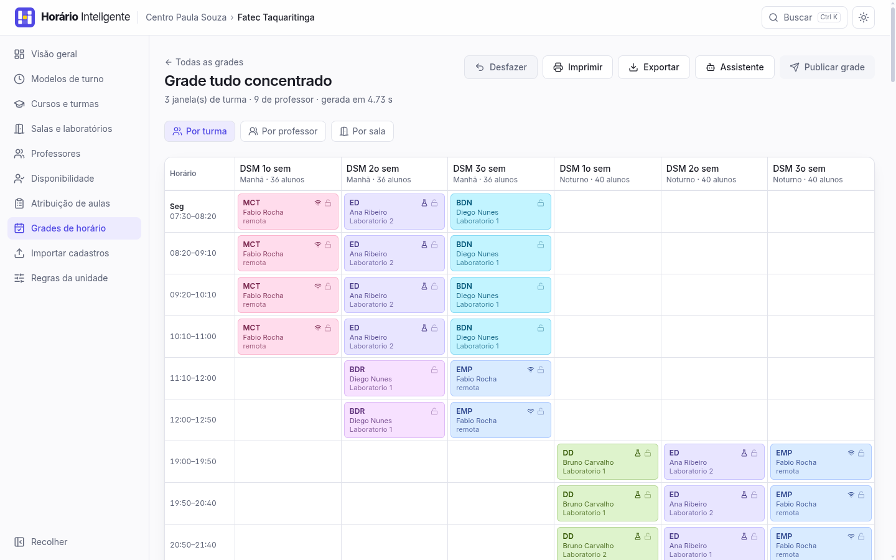
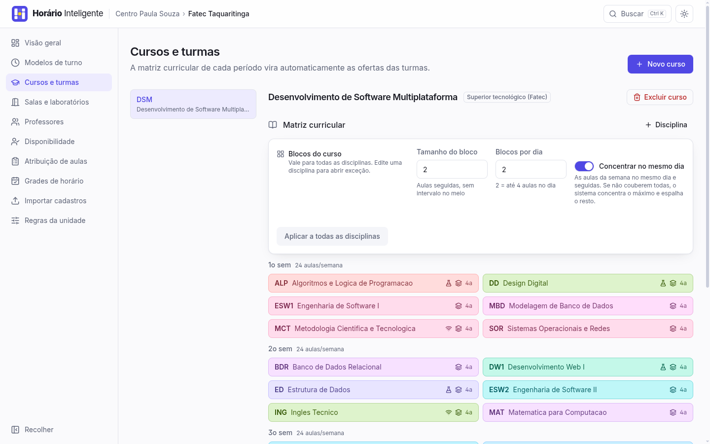
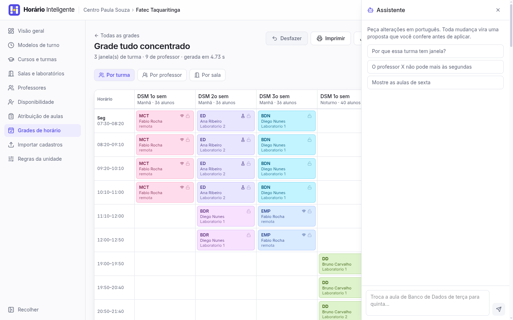
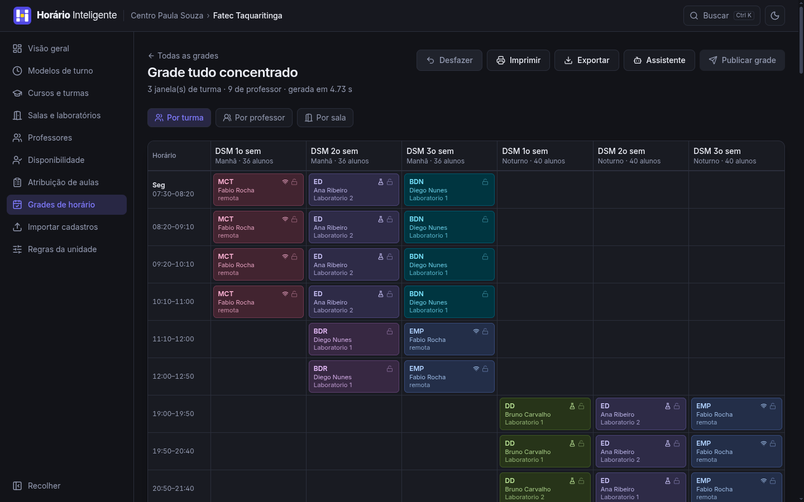

<p align="center">
  <picture>
    <source media="(prefers-color-scheme: dark)" srcset="docs/marca/horizontal-escuro.svg">
    
  </picture>
</p>

# Horário Inteligente

Geração automática de grades de horário de professores para unidades do
**Centro Paula Souza** (Fatecs e Etecs), com edição manual e um assistente que
altera a grade por linguagem natural.

O motor de alocação é o **CP-SAT do Google OR-Tools**. Toda alteração — do solver,
do arrastar-e-soltar ou do chat — passa pelo **mesmo validador**.

> **Estado atual: as 10 etapas concluídas** — scaffold, modelo de dados, seed,
> cadastros, validador único, atribuição sugerida, o **solver CP-SAT** com job
> assíncrono e diagnóstico, a **visualização da grade** com avisos e publicação,
> a **edição manual** por arrastar e soltar com desfazer, o **assistente** que
> edita a grade por linguagem natural, a **exportação**, o **versionamento** e a
> **importação** de cadastros, e o polimento final. Veja
> [`docs/PLANO.md`](docs/PLANO.md) para a arquitetura completa e
> [`docs/DECISOES.md`](docs/DECISOES.md) para o registro de decisões.

---

## Telas

| | |
|---|---|
|  |  |
|  |  |

As vinte telas estão em [`docs/prints/`](docs/prints), numeradas na ordem de uso: dos cadastros
à grade publicada. A marca — símbolo, assinaturas, cores e a explicação do desenho — está em
[`docs/marca/`](docs/marca/apresentacao.png).

---

## Como rodar

### Com Docker (tudo junto)

```bash
cp .env.example .env
docker compose up --build
```

- Frontend: <http://localhost:8080>
- API + documentação interativa: <http://localhost:8000/docs>
- PostgreSQL: `localhost:5432`

As migrations rodam sozinhas na subida da API.

### Em desenvolvimento (SQLite, sem Docker)

Pré-requisitos: [`uv`](https://docs.astral.sh/uv/) e **Node 22+** — o jsdom dos
testes usa uma API que não existe no Node 20 (`webidl.util.markAsUncloneable`),
e a suíte do frontend nem chega a iniciar.

```bash
make instalar     # uv sync + npm install
make seed         # recria o banco SQLite com os dados de exemplo
make api          # http://localhost:8000
make web          # http://localhost:5173  (proxy /api -> :8000)
```

`make ajuda` lista todos os alvos. Os principais:

| Alvo | O que faz |
|------|-----------|
| `make instalar` | Dependências de backend e frontend |
| `make migrar` | `alembic upgrade head` |
| `make seed` | Recria o banco com os dados da seção 9 da especificação |
| `make teste` | pytest + vitest |
| `make lint` | ruff + oxlint + `tsc --noEmit` |
| `make up` / `make down` | Docker Compose |

---

## Variáveis de ambiente

Copie `.env.example` para `.env`, **na raiz do projeto**. Nenhuma é obrigatória para o
sistema funcionar. O Compose e a API em desenvolvimento leem o mesmo arquivo; um
`backend/.env`, se existir, prevalece sobre ele. Depois de mudar o `.env`, reinicie a API.

| Variável | Padrão | Para quê |
|----------|--------|----------|
| `DATABASE_URL` | `sqlite+pysqlite:///./horario.db` | Banco. O Compose injeta a URL do PostgreSQL. |
| `CORS_ORIGINS` | `http://localhost:5173` | Origens liberadas, separadas por vírgula. |
| `OPENAI_API_KEY` | — | Chave da OpenAI. **Só no backend.** |
| `OPENAI_MODEL` | — | Nome do modelo. Não é fixado no código — consulte a documentação atual da OpenAI. |
| `VITE_API_URL` | `/api` | Só se o frontend for apontar direto para a API. |

**Sem `OPENAI_API_KEY` e `OPENAI_MODEL` o sistema funciona normalmente**; o painel
de chat mostra "Chat desativado: configure a chave".

---

## Dados de exemplo

`make seed` cria o escopo **Centro Paula Souza** com:

- **Fatec Taquaritinga** — preset noturno de 4 aulas em 2 blocos + sábado, curso
  DSM do 1º ao 3º semestre (24 aulas semanais por turma, uma disciplina remota por
  semestre), 8 professores com pontuações distintas, 2 laboratórios e 3 salas.
- **Etec Taquaritinga** — preset técnico modular noturno, curso Técnico em
  Desenvolvimento de Sistemas (Módulos I e II) com um componente de divisão
  **paralela** e outro **sequencial**, mais uma 1ª série de ETIM diurno.
- **Paulo Serrano**, que leciona nas duas unidades — é o cenário de choque entre
  unidades e de interjornada (aula até 22h30 na Fatec, aula às 07h00 na Etec).
- Duas disputas de horário: uma decidida por **pontuação** (Ana 87,5 × Bruno 72,0)
  e outra por **empate resolvido na assiduidade** (Gisele × Henrique, ambos 61,0).

### Massa de dados

`make seed` é o exemplo mínimo. Para ver o sistema cheio:

```bash
make massa           # 16 unidades, 200 turmas, ~500 professores
make massa-grades    # idem, e roda o solver em cada unidade (alguns minutos)
```

Isso acrescenta o escopo **Região de Campinas** — oito cidades, cada uma com
uma Fatec e uma Etec, parte dos docentes lecionando nas duas. O seed da spec
continua onde estava; `--limpar` apaga tudo antes, se preferir só a massa.

| | `make seed` | `make massa` |
|---|---|---|
| Unidades | 2 | 16 |
| Turmas | 6 | 200 |
| Ofertas | 32 | 1.072 |
| Professores | 16 | 504 |
| Espaços | 10 | 264 |

**Toda unidade gerada fecha grade.** O script termina rodando a mesma
pré-validação da tela da unidade e sai com erro se alguma não puder gerar — uma
massa em que "Gerar grade" responde "sem solução" pareceria defeito do sistema.
`tests/test_massa.py` guarda essa promessa, inclusive rodando o solver de
verdade no teste marcado `slow`.

```bash
make massa-conflitos   # a mesma região, sabotada de propósito
```

`--conflitos` é o contrário: depois de povoar, planta em cada cidade um
conflito de cada tipo que o sistema detecta — docente com a noite cheia na
Fatec e na Etec (choque entre unidades), noite na Fatec e 07h00 na Etec
(interjornada), três dias bloqueados em quem tem 12 aulas, disciplina sem
nenhum habilitado, carga máxima abaixo da atribuída, laboratório que a matriz
exige e não existe, e cinco docentes disputando o mesmo dia com empate até o
número de filhos. O script imprime a lista do que plantou e onde, gera as
grades e **publica as das Fatecs**, para a Etec da mesma cidade enxergar a
ocupação do docente compartilhado. Unidades que não fecham são esperadas aqui.

---

## Como o solver enxerga o problema

Resumo; a formulação completa está em [`docs/PLANO.md`](docs/PLANO.md) §5.

Cada oferta é quebrada em **blocos** (4 aulas com bloco 2 → dois blocos de 2).
A variável de decisão é `x[bloco, slot] ∈ {0,1}`: "este bloco começa neste slot".
Um slot só vira candidato se os `k` slots seguintes estiverem no **mesmo bloco do
modelo de turno** (é assim que um bloco geminado nunca atravessa um intervalo), se
o professor não estiver indisponível ali e se ele não tiver aula em outra unidade
do escopo naquele horário.

As restrições rígidas são as usuais de timetabling — um professor, uma turma e um
espaço por slot — com três particularidades do CPS:

- subturmas **A** e **B** de uma divisão **paralela** devem cair no mesmo slot;
- disciplinas **remotas** ocupam o slot da turma mas não consomem sala nem laboratório;
- a ocupação de professores em **outras unidades do mesmo escopo** entra como
  ocupação fixa, o que detecta choque entre a Fatec e a Etec da mesma cidade.

O objetivo é uma soma ponderada (ou uma otimização lexicográfica, configurável) de:
janelas da turma → janelas do professor → preferências atendidas ponderadas pela
**pontuação do docente** → dias de deslocamento → estabilidade em relação à grade
anterior. É o termo de preferência ponderada que implementa o art. 7º da Portaria
CETEC 1.263/2017: no mesmo horário disputado, prevalece o mais bem classificado.

---

## O validador único

`app/scheduling/validator.py` é a **única** definição das regras de uma grade.
Usam ele: o pós-solver, o arrastar-e-soltar, as ferramentas do chatbot e o botão
publicar. É uma função pura — recebe um `GradeState` (que já inclui as aulas
publicadas nas outras unidades do escopo) e devolve violações em português,
prontas para virar `Aviso`.

São 21 checagens, de choque de professor/turma/espaço a interjornada, carga
semanal, bloco que atravessa intervalo, divisão de turma e janelas.

Antes do solver roda a **pré-validação** (`prevalidate.py`), que troca um
`INFEASIBLE` sem explicação por uma frase que nomeia o responsável:

> *Não há onde encaixar um bloco de 2 aula(s) de ALP (DSM 1º sem) com Ana
> Ribeiro: o professor marcou o horário como indisponível.*

As duas devolvem o mesmo tipo e aparecem no mesmo painel da tela da unidade.
`GET /unidades/{id}/pre-validacao` e `GET /grades/{id}/validacao` expõem as duas.

---

## Atribuição de aulas

O ato de atribuição do CPS é um procedimento, não uma otimização: a lista de
classificação docente é percorrida e cada docente escolhe suas aulas na sua vez.
`app/scheduling/assignment.py` reproduz isso.

- **Etec** (Deliberação 23/2015): duas passadas — *manutenção* das aulas que o
  docente já lecionava, depois *ampliação* de carga.
- **Fatec** (Deliberação 52/2019): passada única, contratos por prazo
  indeterminado primeiro.
- Dentro da vez de cada docente: componente do concurso > lecionava antes >
  habilitado.

Quando mais de um docente podia assumir a mesma oferta, o sistema registra quem
levou e **qual critério decidiu**:

> *Gisele Tavares e Henrique Lopes podiam assumir DW1 (DSM 2º sem). A prioridade
> ficou com Gisele Tavares por empate em 61 pontos, decidido por assiduidade e
> pontualidade (20 × 12) (Portaria CETEC 1.263/2017, art. 7º).*

A ordem dos critérios de desempate vem de `config_regras`, então a unidade pode
mudá-la sem alterar o código.

---

## A grade pronta

Três visões sobre os mesmos dados — **por turma** (o formato oficial: dia × aula
nas linhas, semestre nas colunas), **por professor** e **por sala**. Cada
disciplina tem uma cor estável em todas as telas, e ícones marcam aula remota,
laboratório e aula fixada. Horário vago com aula depois no mesmo dia aparece
destacado e escrito como "janela".

As linhas são faixas de horário `(dia, início, fim)`, e não o número da aula:
uma unidade pode ter turnos com horários diferentes, e duas "1ª aula" em
horários distintos não são a mesma linha.

A grade só é **publicada** quando não há aviso bloqueante e todos os alertas têm
um "Estou ciente" registrado, com quem e quando. Regerar a grade preserva a
ciência dos avisos que continuam valendo.

**Resolver avisos** regera a grade a partir da atual exigindo zero janela de
turma, zero janela de professor e 11 h de interjornada como regra, não como
custo. O que não tem como ser atendido com a disponibilidade e os blocos
cadastrados é provado inviável, relaxado, e a grade sai mesmo assim, com uma
mensagem nomeando o que ficou — por exemplo, com geminadas de 2 aulas num bloco
de 3 horários no sábado, toda turma de 24 aulas fica com uma janela, e a única
saída é mudar o tamanho do bloco ou a carga do sábado.

A impressão sai em paisagem, no tema claro, com as cores das disciplinas
preservadas e sem cortar aulas entre páginas.

### Blocos e o "4 + 2"

Três campos da disciplina decidem o formato do dia, e os três podem ser
aplicados ao **curso inteiro** em "Cursos e turmas" (a disciplina continua
editável como exceção):

- **Tamanho do bloco** — aulas seguidas *sem intervalo no meio*. 2 é a
  geminada. 4 só funciona num turno que tenha quatro horários sem intervalo.
- **Blocos por dia** — quantos blocos da disciplina podem cair no mesmo dia.
  1 espalha pela semana; 2 *permite* juntar.
- **Concentrar no mesmo dia** — todas as aulas da semana num dia só e
  seguidas, um par de cada lado do intervalo, **sempre que couber**.

Uma manhã de seis aulas sai como **4 + 2** quando uma disciplina concentrada
encontra uma espalhada, e como **2 + 2 + 2** quando as três são espalhadas.

A concentração é a prioridade mais alta do objetivo, não uma regra que trava:
numa manhã de cinco dias cabe uma disciplina concentrada por dia, então com
seis marcadas o solver concentra cinco e espalha a sexta (**5 + 1**), e com
quatro marcadas todas ficam concentradas (**4 + 2**). A tela da unidade avisa
antes de gerar quantas ficam de fora, e a grade diz qual. O peso está em
"Regras da unidade", como os outros.

### Edição manual

Arrastar uma aula move o **bloco inteiro** — 4 aulas geminadas andam juntas. Ao
começar o arrasto a semana toda acende de uma vez: verde onde o bloco cabe sem
problema, amarelo onde gera alerta, vermelho onde viola regra rígida. É **uma**
consulta ao servidor por arrasto, não uma por célula sobrevoada.

O cadeado em cada aula a fixa: ao regerar, ela não sai do lugar. Todo movimento
entra no histórico e o botão **Desfazer** reverte passo a passo.

Tudo passa pelo mesmo `app/scheduling/apply.py`, que valida antes de gravar — o
mesmo caminho que o chatbot usa.

---

## O assistente

Um painel lateral na tela da grade. O usuário escreve em português — *"a Luciana
não pode mais na terça de manhã"*, *"por que o DSM 2 tem janela na quarta?"* — e
o modelo tem dez ferramentas: quatro que **leem** (grade, entidades, validação de
um movimento, explicação de uma aula) e seis que **propõem** (mover, trocar,
fixar, alterar disponibilidade, regerar um pedaço e desfazer).

**O modelo nunca escreve no banco.** As ferramentas de mudança devolvem uma
*proposta*: um cartão com o "antes → depois" de cada aula afetada e os avisos que
a mudança criaria. Só o clique em **Aplicar** grava, e ele passa pelo mesmo
`apply.py` do arrastar-e-soltar — revalidando contra o estado atual, porque a
grade pode ter mudado entre propor e aplicar. Uma alucinação do modelo vira um
cartão que se descarta.

A resposta chega por SSE, token a token, com as ferramentas usadas visíveis
enquanto o assistente trabalha. As regras daquela unidade entram no prompt do
sistema, então ele não promete o que a configuração proíbe.

A chave da OpenAI fica **só no backend** e o nome do modelo vem de
`OPENAI_MODEL` — nada disso está no código nem chega ao navegador. Sem as duas
variáveis, o painel mostra "Chat desativado: configure a chave" e o resto do
sistema funciona normalmente. Os testes usam um cliente OpenAI falso; nenhum
teste chama a API de verdade.

---

## Exportar, versionar e importar

### Exportar

`GET /grades/{id}/exportar?formato=pdf|xlsx&tipo=turma|professor|espaco` devolve
uma página (ou aba) por turma, por professor ou por sala, em paisagem, com as
cores das disciplinas preservadas. `coluna_id` recorta numa só — é o arquivo que
se entrega na mão de um professor.

O quadro exportado é o corte que a escola usa no mural: **dias nas colunas,
horários nas linhas**. As linhas vêm do turno, não das aulas: a linha vazia das
08h40 é o que informa a janela.

A cor de cada disciplina é recalculada em Python com o mesmo hash e a mesma
conversão OKLCH → sRGB que o navegador usa, para o papel sair com exatamente a
cor da tela.

### Versionar

`POST /grades/{id}/duplicar` cria uma versão com as mesmas aulas, para mexer sem
perder o que já estava bom. Uma versão **é** uma grade: visão, edição, avisos,
publicação e chat funcionam nela sem nenhuma mudança. A cópia nasce fora de
PUBLICADA e recalcula os avisos.

`GET /grades/{a}/comparar?com={b}` diz o que mudou. A unidade de comparação é o
**bloco**, não a hora-aula — mover duas aulas geminadas conta como uma mudança:

> *mudou de horário · LP (TDS Módulo I) · bloco 2*
> *segunda 21h10–22h05 · Lab Informática 1 → segunda 19h00–19h55 · Lab Informática 1*

A tela mostra ainda as métricas do solver lado a lado, com a diferença entre as
duas versões.

### Importar

`GET /importar/modelos` lista o que dá para importar — professores, matriz
curricular, turmas, salas e habilitações — com a ajuda de cada coluna;
`/importar/modelos/{tipo}/arquivo` baixa a planilha de exemplo em CSV ou Excel
(no `.xlsx`, a ajuda vem como comentário de célula).

`POST /importar/csv` **confere primeiro e grava depois**: sem `aplicar=true` a
importação roda inteira e é desfeita, devolvendo linha por linha o que seria
criado, atualizado ou recusado. Com `aplicar=true` só grava se nenhuma linha
tiver erro. Um erro nunca derruba o arquivo — vira uma linha do relatório:

> *Linha 6 — 'tipo_contrato' veio 'VITALICIO'; os valores aceitos são:
> INDETERMINADO, DETERMINADO.*

Acento, caixa e espaço no cabeçalho são ignorados, a vírgula decimal é aceita
(87,5) e o `;` do Excel em português também. Reimportar atualiza sem duplicar: a
chave é o identificador. Importar um docente que já existe noutra unidade do
escopo **acrescenta o vínculo** em vez de criar um gêmeo — é esse o cadastro que
faz o sistema detectar choque entre a Fatec e a Etec da mesma cidade.

---

## Regras configuráveis por unidade

Nenhum número de negócio está no código. Cada unidade guarda um `config_regras`
com carga máxima semanal, limite diário opcional (CLT art. 318 na redação antiga —
**desligado por padrão**, pois a Lei 13.415/2017 o revogou), interjornada de 11 h
(`off` / `aviso` / `rigida`, CLT art. 66), tempo mínimo de deslocamento entre
unidades, uso de sábado, pesos do objetivo e critérios de desempate.

Criar uma unidade FATEC ou ETEC aplica o preset correspondente; tudo continua editável.

---

## Testes

```bash
make teste
```

Backend com pytest (foco no solver e no validador), frontend com Vitest e Testing
Library. O CI (`.github/workflows/testes.yml`) roda lint, build e testes dos dois
lados a cada push.

### Desempenho

Os testes de desempenho ficam atrás do marcador `slow` e rodam por último:

```bash
cd backend && uv run pytest -m slow      # só eles
cd backend && uv run pytest -m "not slow"  # o resto
```

Cobrem o porte da seção 10 da spec — 10 turmas, 40 professores, 200 blocos:

| O que | Medido | Limite do teste |
|-------|--------|-----------------|
| Solver achar uma grade viável | ~20 s | 70 s |
| `validar` a grade inteira | ~3 ms | 50 ms |
| `destinos_possiveis` (um arrasto) | ~100 ms | 1,5 s |
| `calcularJanelas` no navegador | <1 ms | 16 ms |
| Desenhar 200 aulas (jsdom) | ~270 ms | 3 s |

Os limites são folgados de propósito: servem para pegar regressão de ordem de
grandeza, não para cravar milissegundos numa CI compartilhada. `validar` e
`destinos_possiveis` estão aí porque rodam a cada arrasto e a cada ferramenta do
chat — e, ao contrário do solver, não têm barra de progresso que justifique a
espera.

---

## Telas disponíveis

| Tela | O que faz |
|------|-----------|
| Escopos e unidades | CRUD; criar unidade já aplica o preset do tipo escolhido |
| Modelos de turno | Editor visual da semana, com bloco e intervalo explícitos |
| Cursos e turmas | Matriz curricular por período e turmas; as ofertas são geradas junto |
| Salas e laboratórios | CRUD, com aviso quando a matriz exige um tipo de lab inexistente |
| Professores | Classificação por pontuação, vínculo por unidade e habilitações |
| Disponibilidade | Grade clicável dia × aula, com "dia inteiro" e "copiar de outro dia" |
| Atribuição de aulas | Sugestão pela norma, edição manual e a lista de classificação com a carga de cada docente |
| Grades de horário | Geração em segundo plano com parâmetros, progresso ao vivo e diagnóstico quando não há solução |
| Grade | Visão por turma, professor e sala; janelas destacadas; avisos com "Estou ciente" e publicação |
| Importar cadastros | Planilha de exemplo, conferência linha a linha e gravação só sem erros |
| Comparar versões | Duas grades lado a lado: métricas, e o que mudou aula por aula |
| Regras da unidade | Carga, jornada, interjornada, atribuição e pesos do objetivo |
| Assistente | Painel lateral na tela da grade: conversa em português, propostas com "antes → depois" e Aplicar/Descartar |

### Como a interface se comporta

- **Tudo que dá para prever é otimista**: a tela muda na hora e desfaz com um
  toast se o servidor recusar — inclusive publicar, desfazer e duplicar uma
  versão. O que só o servidor sabe calcular (sugerir atribuição, gerar grade)
  mostra progresso em vez de fingir um resultado.
- **Sem tela de carregando**: prefetch no hover, cache no IndexedDB e esqueletos
  com o formato do conteúdo — a tabela de horário tem um esqueleto de tabela, a
  lista de grades um de cartões, para a página não pular quando os dados chegam.
- **Tema claro e escuro**, aplicado antes da primeira pintura (sem o clarão de
  um quadro ao carregar). O contraste de texto foi medido nas dez telas, nos
  dois temas, e passa os 4,5:1 da WCAG AA.
- **Teclado e movimento**: `Ctrl+K` abre a paleta de comandos; todo controle
  focável tem anel de foco visível; `prefers-reduced-motion` desliga as
  animações de uma vez, na raiz.

---

## Limitações conhecidas

- A importação cobre professores, disciplinas, turmas, salas e habilitações.
  Modelos de turno e disponibilidade continuam só pelas telas, que são
  visuais.
- As propostas do assistente vivem em memória: reiniciar a API invalida as que
  estavam pendentes, e a tela pede para refazer o pedido.
- A interjornada em modo "aviso" é verificada depois da solução, não otimizada
  pelo solver: ela não está entre os critérios do objetivo na especificação.
- O solver é executado em processo (`BackgroundTasks` + thread pool), adequado a
  uma unidade gerando uma grade por vez. Execução distribuída exigiria Celery/RQ.
- Os presets de horário são aproximações dos horários publicados pelas unidades
  citadas na especificação e existem para serem editados, não para valerem como
  horário oficial de nenhuma escola.
- A detecção de choque entre unidades considera apenas grades **publicadas** das
  outras unidades do mesmo escopo.
- Não há autenticação nem perfis de acesso: quem alcança a API faz tudo. A spec
  não pede, e o sistema foi pensado para rodar na rede da unidade.
- O separador `›` da trilha de navegação fica em 3:1. É decorativo e marcado
  `aria-hidden` — a WCAG isenta —, mas está anotado aqui porque o restante da
  interface passa os 4,5:1.
